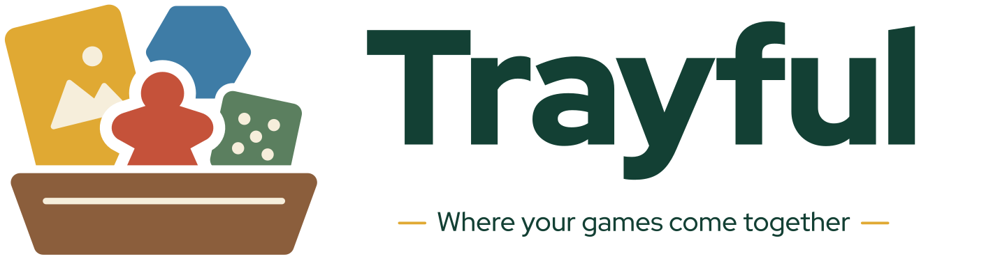
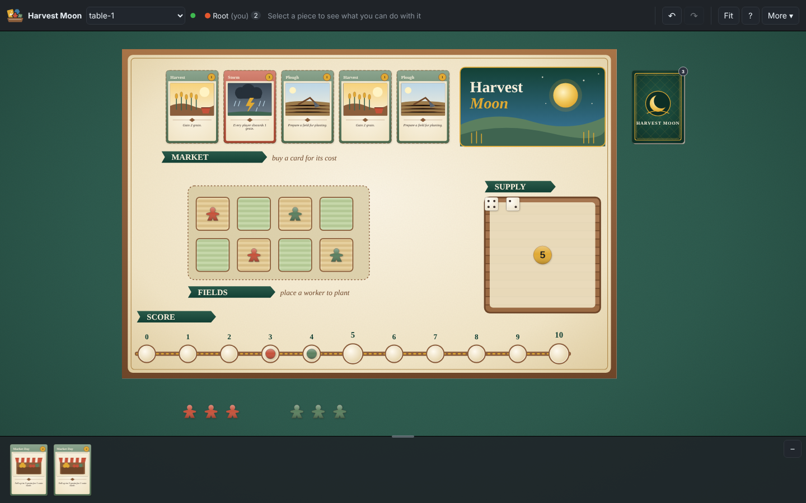

<h1 align="center">
  <picture>
    <source media="(prefers-color-scheme: dark)" srcset=".github/readme/logo-dark.svg">
    
  </picture>
</h1>

<p align="center">A boardgame prototyping table for people and AI agents.</p>

<p align="center">
  <a href="https://www.npmjs.com/package/trayful"></a>
  <a href="https://github.com/cverdoes/trayful/actions/workflows/ci.yml"></a>
  <a href="LICENSE.md"></a>
  
</p>

Describe your components (cards, boards, tokens, meeples, dice, counters) in plain YAML files, or design them in the browser, and Trayful lays them out on a table where people and AI agents can drag, flip, rotate, stack and shuffle them.



## Features

- **A real table in your browser.** Drag, flip, rotate, stack, draw, shuffle, roll and count, with undo and snapping onto board spots.
- **Components as files.** Libraries, inventory, card data and setups are plain YAML and CSV that diff like code, and the table updates as you save. Or build them in the browser with the designer.
- **Playtest with others.** Send an invite link over your network or through a tunnel; every player has a private hand.
- **AI agents over MCP.** Claude and other MCP clients can play on the table and build components with you, and you see their moves live.
- **Print and play.** Print every component at real size.

## Getting started

With [Node.js](https://nodejs.org/) 22.12 or newer:

```sh
npx trayful new my-game      # a new prototype from the starter template
npx trayful play my-game     # open it on a table in your browser
```

To let Claude Code play on the open table, connect it once from another terminal, then ask it to deal a round:

```sh
claude mcp add --transport http trayful http://127.0.0.1:4317/mcp
```

## Documentation

The [documentation site](https://cverdoes.github.io/trayful/) has two halves:

- **[User guide](https://cverdoes.github.io/trayful/guide/index.html)**: [getting started](https://cverdoes.github.io/trayful/guide/getting-started.html), [playing on the table](https://cverdoes.github.io/trayful/guide/playing.html), [playing with others](https://cverdoes.github.io/trayful/guide/play-with-others.html), [letting an agent play](https://cverdoes.github.io/trayful/guide/agents.html), [making your own prototype](https://cverdoes.github.io/trayful/guide/your-own-prototype.html), [running it in Docker](https://cverdoes.github.io/trayful/guide/docker.html), plus the [HOWTO guides](https://cverdoes.github.io/trayful/howto/index.html) and the [format reference](https://cverdoes.github.io/trayful/reference/index.html).
- **[Contributors](https://cverdoes.github.io/trayful/contributors.html)**: building Trayful from a clone, the commands and checks, releasing, and the architecture: how it runs, the decisions behind it, walkthroughs, packages and modules.

The same pages are in this repository, in [`docs/`](docs/README.md) and [`architecture/`](architecture/README.md).

## Contributing

You need Node.js 22.12 or newer and [pnpm](https://pnpm.io/) 10 (`corepack enable` gets it).

```sh
git clone https://github.com/cverdoes/trayful.git
cd trayful
```

<!-- quickstart:start -->

```sh
pnpm install
pnpm build
pnpm trayful validate examples/harvest-moon
pnpm trayful play examples/harvest-moon
```

<!-- quickstart:end -->

`play` opens Harvest Moon, the sample game, at http://127.0.0.1:4317. CI runs exactly the commands between the quick-start markers above on a clean checkout. See [Develop Trayful](https://cverdoes.github.io/trayful/concepts/develop.html) for the repository layout, every command and the checks a change must pass, and [CONTRIBUTING.md](CONTRIBUTING.md) for how to send a change.

## Licence

Trayful is source-available under the [Functional Source License 1.1, MIT Future License](LICENSE.md) (FSL-1.1-MIT). You may use, copy, change and share it for any purpose, including designing games you sell, except offering it to others as a commercial product or service that competes with Trayful, such as a paid hosted version. Each release becomes MIT-licensed two years after it is published.

The games in `examples/` are covered by the same licence unless their own README says otherwise.
