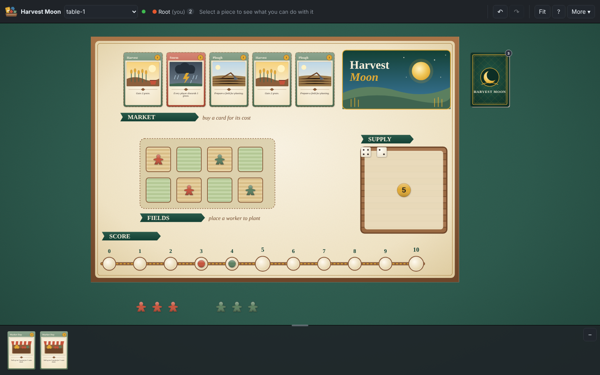

# Getting started

Trayful is a table for prototyping board games. Describe your components (cards, boards, tokens, meeples, dice, counters) in plain YAML files, or design them in the browser, and Trayful lays them out on a table where people and AI agents can drag, flip, rotate, stack and shuffle them.



## Install

With [Node.js](https://nodejs.org/) 22.12 or newer, you need nothing else:

```sh
npx trayful new my-game      # a new prototype from the starter template
npx trayful play my-game     # open it on a table in your browser
```

Or install it once with `npm install -g trayful` and leave out the `npx`. The guides use `npx trayful`; with a global install, type `trayful`.

The new project has a deck of cards loaded from a spreadsheet, some tokens and a setup. Its files are in the `my-game` folder: keep the table open while you edit them, and it updates every time you save.

## Let Claude play

With the table open, connect Claude Code to it from another terminal, once:

```sh
claude mcp add --transport http trayful http://127.0.0.1:4317/mcp
```

Then ask Claude something like "shuffle the deck, deal three cards to two players and play a round", and watch its moves on your table. [Let an agent play](agents.md) has the other ways to connect, and what agents can do.

## Next

- [Playing on the table](playing.md): moving, drawing, flipping and every shortcut.
- [Make your own prototype](your-own-prototype.md): what is in a project folder, and where to start.
- [The HOWTO guides](../howto/README.md): a deck of cards, a board with spots, your own images and more, step by step.
