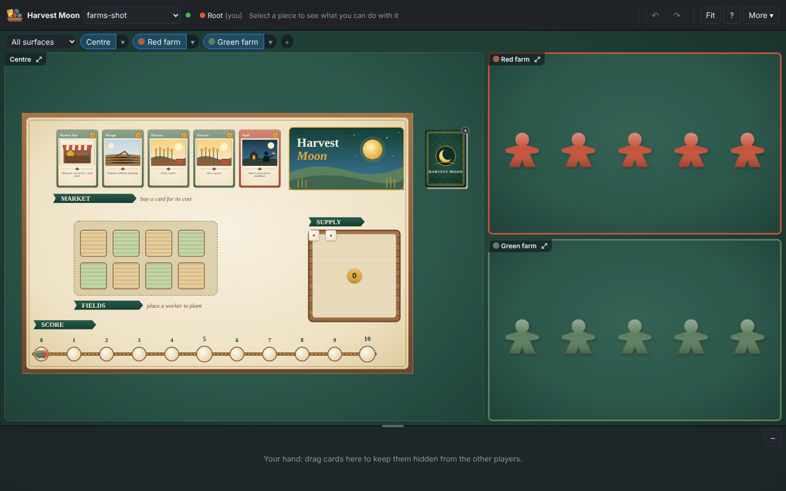

# Playing on the table

## Moving pieces

Drag a piece to move it. While you drag, the board spots it may go to light up, and dropping it near one snaps it in; pieces on a board move along with the board. Drag the top card off a pile to draw it, and drop cards on a pile to stack them; hold Shift to drag a whole pile. Pieces sharing a group spot, like markers on a score track, stay separate: click one to list them all and pick the one you want. Double-click a card to flip it or a die to roll it. Click to select, Shift+click or Shift+drag on empty table to select several, then use the buttons that appear in the toolbar for what you selected, or the keys: **F** flip, **Q**/**E** rotate, **D** draw, **S** shuffle, **V** fan or spread a pile out (then drag out any card), **R** roll, **+**/**−** counters, **L** lock or unlock (setups can lock a board in place), **H** shrink your hand to a bubble and back, **Ctrl+Z** undo. Hold **Space** over a piece to see it large in the middle of the screen, so its text is easy to read (a board shows with everything on it); a quick tap keeps it there until the next. Drag empty table to pan, scroll to zoom, **0** to fit, **?** for all shortcuts.

## Tables

A new table starts from the setup named in `trayful.yaml` (Harvest Moon's puts the board in the middle, deals the market and lines up the workers). The table is saved to `tables/table-1.json` inside the project folder as you play, and reopens where you left off. **Start over** in the toolbar's **More** menu sets the table up again from the project files (you can undo it). The menu next to the game's name switches tables: make a **new table** for another playtest, **duplicate** one to try two moves from the same position, or delete one. **Print and play** in **More** opens [print-and-play](../howto/print-and-play.md) sheets with every component at real size.

## Surfaces

A table can also have [surfaces](../reference/surfaces.md): separate play spaces such as a farm for each player, each in a tile of its own with its own pan and zoom. The chips under the toolbar switch tiles on and off, or show just yours and the Centre; drag pieces from tile to tile or drop them on a chip. Harvest Moon's `2-player-farms` setup gives each player a farm (`--setup 2-player-farms`).

## Options

Options for `trayful play`, after the folder:

| `trayful play` option | What it does                                                |
| --------------------- | ----------------------------------------------------------- |
| `--project <id>`      | In a folder of projects, the one to open first              |
| `--table <name>`      | Open or create another saved table, e.g. `--table b`        |
| `--seed <n>`          | Shuffle seed for a new table, for repeatable games          |
| `--setup <name>`      | Setup for a new table; `none` lays everything out           |
| `--port <n>`          | Use another port than 4317                                  |
| `--no-open`           | Do not open a browser window                                |
| `--share`             | Let others on your network join, by invite link             |
| `--tunnel`            | Let others anywhere join, through a Cloudflare tunnel       |
| `--container`         | Run inside a container; see [Run it in Docker](docker.md)   |
| `--no-pace`           | Answer agents at once, not after people have seen each move |
| `--yes`               | Serve a folder with other files in it without asking first  |
